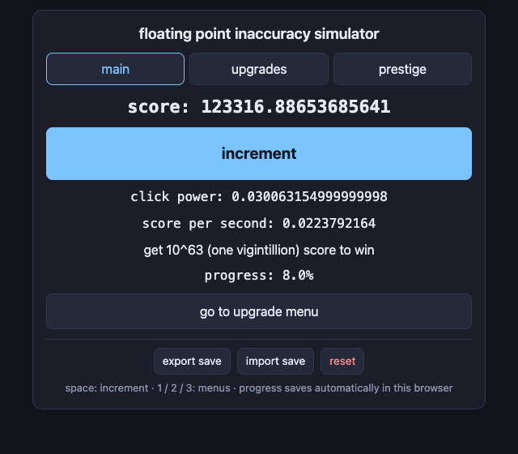
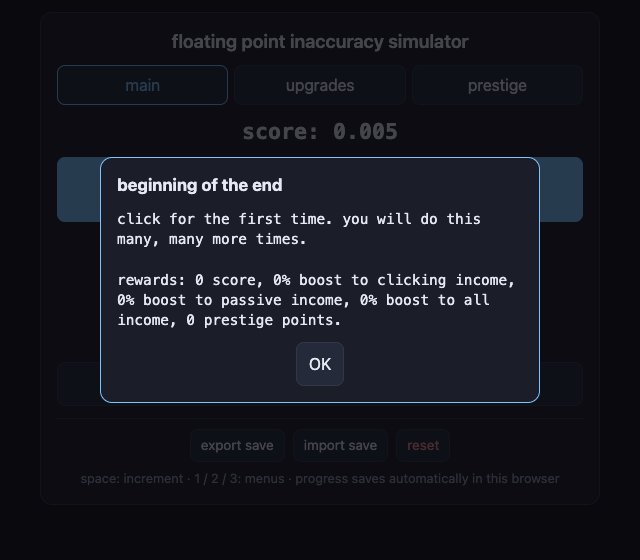
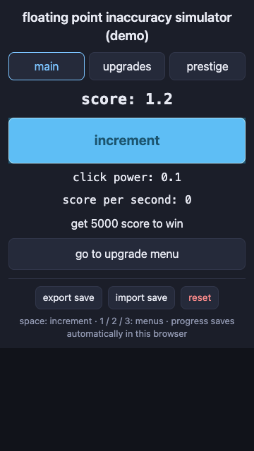
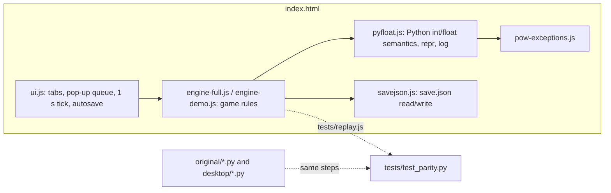

# floating point inaccuracy simulator

A simple and extremely long clicker game where every number is shown exactly as the
computer stores it. Originally written in Python with Tkinter by **PZ**; this repository
also has a browser version, ready for GitHub Pages, itch.io or any static web host.

**Play in the browser:** https://hanswei.github.io/floating-point-inaccuracy-simulator/
(full game: [/full/](https://hanswei.github.io/floating-point-inaccuracy-simulator/full/),
demo: [/demo/](https://hanswei.github.io/floating-point-inaccuracy-simulator/demo/)).
Downloads for offline play are on the
[Releases](https://github.com/HansWei/floating-point-inaccuracy-simulator/releases) page.

Two editions:

- **full game** (`original/floating_point_inaccuracy_simulator.py`): win at 10^63 score, 24
  achievements plus 5 hidden ones, milestones, four prestige upgrades.
- **demo** (`original/floating_point_inaccuracy_simulator_demo.py`): win at 5000 score.
  The web demo also has 22 achievements, scaled down from the full game. They were added
  to a desktop copy first (`desktop/floating_point_inaccuracy_simulator_demo.py`), which
  is the reference the web demo is tested against; see [Demo achievements](#demo-achievements).

The joke of the game is that every number is shown raw, so `0.1 + 0.2` shows up as
`0.30000000000000004`. The port therefore reproduces Python's arithmetic **and** Python's
float printing digit for digit. Tests run the untouched original files and the web
version side by side and require every value and every pop-up to match.

| full game | achievement pop-up | demo on a phone |
|---|---|---|
|  |  |  |

## Quick start

```bash
python3 tools/build.py          # writes dist/ (Python 3.8+, standard library only)
open dist/full/index.html       # or double-click it; no server needed
```

To try it the way a website serves it (landing page with both editions):

```bash
python3 -m http.server 8765 --bind 127.0.0.1 --directory dist
# then open http://127.0.0.1:8765/
```

The build produces one self-contained `index.html` per edition (about 54 KB and 47 KB, no
external requests), a zip for each, and `dist/index.html`, a landing page that links both
editions when `dist/` is hosted as one site:

| file | upload to |
|---|---|
| `dist/floating-point-inaccuracy-simulator-web.zip` | the full game's itch.io page |
| `dist/floating-point-inaccuracy-simulator-demo-web.zip` | the demo's itch.io page |

Controls: click or tap **increment**; <kbd>Space</kbd> also increments (holding it down
does not auto-click); <kbd>1</kbd> <kbd>2</kbd> <kbd>3</kbd> switch between the main,
upgrade and prestige menus.

## Publishing on itch.io

You need an itch.io account. Do this once per edition (full game and demo are best as two
separate project pages, because a page can only have one "played in the browser" upload):

1. Run `python3 tools/build.py`.
2. On itch.io choose **Upload new project**.
3. Set **Kind of project** to **HTML**.
4. Under **Uploads**, upload the edition's zip and tick **This file will be played in the
   browser**.
5. Under **Embed options**:
   - **Embed in page**, viewport **640 × 560** (the layout also adapts to any other size).
   - Tick **Mobile friendly** (orientation: portrait or default). Phones then open the
     game full screen.
   - Optional: **Fullscreen button**. Leave **Scrollbars** off.
   - **Click to play** can be turned off: the page is tiny and has no sound.
6. Fill in the title, cover image and description (the screenshots in `screenshots/`
   can be used), then **Save & view page** and play it once in the preview before setting
   visibility to **Public**.

To update a published game later, either upload the new zip and delete the old one, or use
butler, itch.io's uploader, which keeps the upload and only sends changes:

```bash
butler login                                    # once
tools/publish_itch.sh <user>/<full-slug> <user>/<demo-slug>
```

### Saves on itch.io

Progress is saved automatically in the player's browser (`localStorage`) every second and
when the tab is hidden. Each edition uses its own key, because all itch.io HTML games share
one storage origin. If a browser blocks storage inside the itch.io frame (some privacy
settings do), the game shows a warning and still runs; **export save** and **import save**
let players move or back up progress. The full game's export is the same `save.json` format
as the desktop version, so a desktop save can be imported and vice versa.

### Other hosts

The zips are plain static files, so they also work on Newgrounds, Game Jolt (HTML game
upload), GitHub Pages (next section), Netlify or any web server. Portals such as Poki or CrazyGames
additionally require their own SDK for ads and analytics, which this port does not include.

## Publishing on GitHub

`.github/workflows/publish.yml` does it all:

| when | what happens |
|---|---|
| every push and pull request | builds both editions, runs `tests/smoke.js`, keeps the two itch.io zips as a workflow artifact (run page, **Artifacts**) |
| push to `main` | also deploys the site to GitHub Pages: the landing page, `/full/` and `/demo/` |
| push of a tag `v*` | also creates a release with both zips attached |

Pages is set to **Settings > Pages > Source: GitHub Actions**. To redeploy without a code
change, open the **Actions** tab, choose **build and publish** and **Run workflow** on
`main`.

To publish a release (for example after a game update):

```bash
git tag v1.0.0 && git push origin v1.0.0
```

Saves on Pages work as on itch.io. Each edition keeps its own `localStorage` key; the site
origin is `hanswei.github.io`, which is shared with the account's other Pages sites.

The parity and browser tests are not run in the workflow, because they compare against
macOS Python, whose float results differ slightly from Linux. Run them locally before
publishing a change to the game logic (see [Tests](#tests)).

## How the port works



- **Python numbers in JavaScript** (`web/src/pyfloat.js`). Python ints are BigInt and
  Python floats are JS numbers; mixed arithmetic follows Python's rules (int + int stays
  int, anything with a float becomes float). `str()` of a float uses Python's repr rules
  (shortest round-trip digits, `e+16` style exponents, `.0` on whole numbers).
- **Powers.** Upgrade costs use `0.9 ** n`, `1.5 ** n`, `0.95 ** n` and so on. JavaScript's
  `Math.pow` disagrees with Python in about 9% of these cases, which would change costs.
  The port computes the exactly rounded power with BigInt, then applies a table of the 39
  cases (out of about 12,000 that the game can reach) where Python's C library is itself one
  unit off. `tools/gen_pow_exceptions.py` regenerates the table.
- **Logarithms** (`log(score, 10)` and `log(score, 5)` for prestige points and progress).
  JavaScript's `Math.log` is not exact and differs between browsers, which can turn 9
  prestige points into 8 right next to a power of 10. The port computes a correctly rounded
  log with BigInt instead (`crLog`). macOS's C library is not always correctly rounded
  either (about 1 input in 7,000 is one unit off), so `tools/check_log_rounding.py` scans
  every score near every prestige and progress boundary, up to the largest float (15.7
  million scores), and confirms the truncated results always match Python.
- **Rules** (`engine-full.js`, `engine-demo.js`) are a line-by-line port of the original
  functions, keeping their names and quirks (for example an achievement's reward is
  evaluated twice, and the full game's prestige resets upgrade levels to 0 while the demo
  resets them to 1).

## Demo achievements

The original demo has no achievements. The web demo adds the full game's system, scaled
to a game that is won at 5000 score. The change was made in Python first, in
`desktop/floating_point_inaccuracy_simulator_demo.py` (a copy of the original demo plus
the achievement code, started like the original with `python3 desktop/...`; the tests run
it with a stand-in for Tkinter), so the web demo is tested against real Python like
everything else. Without any achievement unlocked it plays
exactly like the original demo (`test_demo_rules_unchanged_apart_from_achievements`).

| achievement | goal | reward |
|---|---|---|
| the name of the game | score reaches 0.30000000000000004 (three clicks) | 1e-17 score |
| beginning of the end | first click | |
| making progress | 500 score | +5% passive, +5% all income |
| halfway there! | 2500 score | +2% all income, 1 prestige point |
| time wasters: wasters of time | 1000 score before earning any prestige point | -1 score |
| lol | first prestige point earned | -0.1% all income |
| hoarder | 10 prestige points at once | +1% clicking |
| carpal tunnel syndrome | 1000 clicks | 10% of score, +1% passive |
| filler text | 1947 clicks | 1% of score, +1% clicking, 1 prestige point |
| autoclicker | 10000 clicks | +1% clicking, +0.5% all income |
| cheater! | more than 20 clicks per second on average | -20% of score, -10% clicking, +1% passive |
| i got you a gift! | 492 seconds played | +1% all income, 1 prestige point |
| stop. | 600 seconds played | |
| go touch grass | 24 hours played | +5% all income, 1 prestige point |
| bankruptcy | 100 upgrade clicks you could not afford | |
| need a loan? | 1000 upgrade clicks you could not afford | 10% of score, -1% clicking |
| free sample | an upgrade that cost 0 (after 7 or more "cheaper upgrades") | 2.5 score, 1 prestige point |
| 100 percenting ... (demo) any % speedrun | every achievement above | +5% all income, 5 prestige points |
| why? (hidden) | prestige with less than 10 score | -1% all income |
| take a break. (hidden) | 42 unaffordable clicks, checked 35 s after one | |
| the average costco: (hidden) | prestige with 10+ score without paying for an upgrade | +1% clicking, 1 prestige point |
| lazy. (hidden) | prestige with 10+ score without clicking increment | +0.1% clicking, -0.1% passive |

Choices: the full game's achievements tied to 10^63 score, milestones, the sps prestige
upgrade or 50 years of play were left out because the demo has none of those. "making
progress" gives no prestige point, so "time wasters" stays possible: reaching 1000 score
before the 492-second gift or the 1947th click takes about 4 clicks per second, which makes
it a speed challenge (the full game's "lol" achievement tells players when they have missed
it). The demo's labels show income including the boosts, and the "instant 3 minutes"
prestige upgrade uses the boosted income, like the full game.

## Tests

```bash
python3 -m pip install pytest playwright      # playwright only for the browser tests
python3 tools/build.py
python3 -m pytest -q tests                    # needs Node.js 16+ on PATH
node tests/smoke.js                           # quick check, runs anywhere (used by CI)
python3 tools/check_log_rounding.py           # optional, about a minute
```

- `tests/test_parity.py` loads each original `.py` (and the desktop demo with
  achievements) with a fake Tkinter, plays 27 scripted and random games (over 24,000
  actions: clicks, purchases, prestiges, ticks, the delayed
  35 s check, and jumps in score, time and clicks that reach every achievement and the win),
  replays them in the JavaScript engines with `tests/replay.js`, and compares every variable
  after every step plus every pop-up's title and text. It also checks that desktop saves
  load identically in the web version and that web saves load identically in the desktop
  version. A one-off run of 400 longer random games (200 per edition, 1,200,000 steps) also
  matched.
- `tests/test_browser.py` drives the built pages in Chrome with a fake clock: it replays
  the scripted stories through real button clicks and compares with the originals, reloads
  inside a sandboxed cross-origin iframe (how itch.io embeds games) to check saving,
  imports a desktop `save.json`, rejects a save that loads but cannot run without touching
  the stored one, checks that a pop-up blocks the buttons behind it (mouse and keyboard),
  checks that a held key does not auto-click, checks a 320 px wide screen for sideways
  scrolling, and fails on any console error.
- `tests/smoke.js` plays 20,000 random actions in each engine with Node alone and checks
  that saves reload exactly. It needs neither Python nor a browser.

## Differences from the desktop originals

Intentional, and kept small:

- **Labels show the values actually used.** In the original full game the click-power
  label applied achievement boosts twice at start-up, and the score-per-second label used
  the score-milestone bonus instead of the upgrade-milestone bonus that income really uses.
  The game rules themselves are unchanged.
- **The save keeps three more counters** (`broke_counter`, `upgrades_paid_for`,
  `run_clicks`). The original did not save them, so reloading could grant "free sample" or
  reset "take a break." progress. The desktop game ignores unknown keys, so saves still
  work in both directions.
- **The demo saves progress** (the original demo had no save) and has achievements (see
  [Demo achievements](#demo-achievements)).
- **Pop-ups pause the game**, as they do in the original full game (its next tick waits
  until the message box is closed). Missed seconds while the page is open in a background
  tab are caught up, up to one hour per gap, so sleeping the computer does not grant a
  windfall. While a pop-up is open, the game behind it cannot be clicked or reached with
  the keyboard.
- **Imported saves are tried first.** A save that loads but cannot run (for example a
  hand-edited upgrade level so high that its cost overflows) is rejected instead of
  replacing the current game.
- **Window wiggle on macOS** (the original's `force_mac_refresh` nudges the window by one
  pixel to force a redraw) is not needed in a browser.

Known limit: the power-exceptions table was generated with Python 3.14 on macOS (Apple
silicon). Python on Windows or Linux uses a different C library and may differ from it in
the last digit for a handful of the 12,000 cost values; the web version always matches the
macOS results.

## Why plain JavaScript (approaches compared)

| approach | download | float output matches Python | work needed | verdict |
|---|---|---|---|---|
| **Plain JS port with Python number layer** (chosen) | ~15 KB zip | yes, tested on every step | rewrite rules + UI, parity tests | best fit for itch.io |
| Pyodide (CPython in WebAssembly) | several MB runtime before the game starts | yes, it is CPython | Tkinter does not run in a browser, so the UI must be rewritten anyway | heavy for a clicker |
| pygbag (pygame in WebAssembly) | several MB | yes | game must be rewritten for pygame (no Tkinter) and an async loop | same rewrite, bigger download |
| Brython / Transcrypt (Python syntax compiled to JS) | small | **no**: floats become JS numbers, so `**` uses `Math.pow`, which differs from Python in ~9% of the game's cost values | still no Tkinter | breaks the game's premise |
| Godot web export | tens of MB | no: GDScript has its own float-to-text rules | full rewrite in GDScript plus the same parity work | overkill |

## Files

```
original/      the two Tkinter games, unchanged (reference for the tests)
desktop/       the demo with achievements as a Tkinter game (reference for the web demo)
web/src/       index.html template, style.css, ui.js, engines, Python number layer
tools/         build.py (dist/ + zips + landing page), publish_itch.sh (butler),
               gen_pow_exceptions.py, check_log_rounding.py
tests/         py_harness.py (runs originals headless), replay.js, pytest suites, smoke.js
.github/workflows/publish.yml   build, smoke test, GitHub Pages and Releases
screenshots/   images for this README and the itch.io page
```

## Copyright and credit

Copyright (c) 2026 PZ. The game, its rules and its text were created by **PZ**, the author.
Please acknowledge PZ as the author wherever you share, modify, port or republish the game,
for example on a store page, in a release or in a fork's README. The code is shared under the
terms in [LICENSE](LICENSE).
